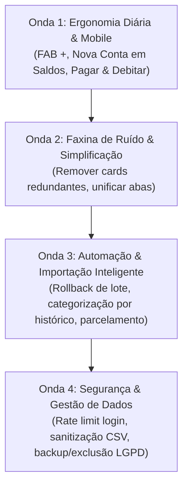

# Auditoria Geral de Produto e UX — Mutano Contas

> **Data:** Novembro de 2026  
> **Escopo:** Auditoria completa de produto, arquitetura de informação, usabilidade mobile/desktop e segurança da aplicação **Mutano Contas** (`C:\Projetos\financeiro_2`).  
> **Abordagem:** Análise estrita sob a ótica de um usuário real brasileiro que gerencia seu dinheiro no dia a dia (salário, despesas fixas, cartão de crédito, compras parceladas, metas de reserva, quitação de dívidas e conciliação bancária).

---

## 1. Visão Geral e Critérios de Avaliação

O **Mutano Contas** possui uma base técnica sólida: Next.js 15 App Router, banco SQLite/Turso via Drizzle ORM, cálculo financeiro determinístico em centavos inteiros (`cents`), tema AMOLED noturno com contraste calibrado e suporte a Open Finance.

No entanto, sob a ótica de usabilidade cotidiana, o aplicativo sofre de três dores estruturais:
1. **Atrito no Lançamento Rápido (Dia a dia na rua):** Para registrar um cafezinho ou almoço, o usuário precisa entrar no menu, navegar até Lançamentos, rolar ou abrir um formulário completo e preencher múltiplos campos. Falta um botão flutuante de ação rápida (FAB) acessível com o polegar.
2. **Desconexão entre Telas Interdependentes:** O usuário cadastra contas e categorias apenas em `/configuracoes`, mas consulta saldos em `/contas`. Ele gerencia compromissos em `/contas-a-pagar`, mas precisa lançá-los manualmente em `/lancamentos` ou depender de uma geração separada em `/recorrentes`.
3. **Sobrecarga de Textos Didáticos e Cards Redundantes:** Quase todas as telas possuem blocos de `Hint` ou `details` explicando conceitos ("O que é 50/30/20", "Como começar"). Embora útil no primeiro dia, após duas semanas isso vira ruído visual permanente que empurra os dados reais para fora da primeira dobra da tela.

### Critérios de Classificação

- **Prioridade:**
  - **P1 (Crítica):** Impacta diretamente a rotina de controle financeiro, gera confusão de cálculo/saldo ou representa vulnerabilidade de segurança.
  - **P2 (Importante):** Melhora expressiva de usabilidade, redução de passos/cliques, clareza de fluxo ou ergonomia mobile.
  - **P3 (Refinamento):** Polimento visual, micro-interações, atalhos de teclado e conveniências secundárias.
- **Esforço:**
  - **P (Pequeno):** Menos de 2 horas (ajuste de copy, remoção de componente, classe CSS, prop).
  - **M (Médio):** Meio período (novo componente de UI, ajuste em query/server action, modal/sheet).
  - **G (Grande):** Mais de 1 dia (nova modelagem de schema, fluxo multi-etapas, motor de automação).

---

## 2. Diagnóstico Tela a Tela

---

### 2.1. Landing Page (`src/app/page.tsx`)
- **Objetivo:** Apresentar a proposta de valor do Mutano Contas e converter novos usuários para o cadastro/login.
- **O que confunde / sobra:**
  - O texto "Didático de propósito" enfatiza teoria financeira, quando o usuário que busca um app quer **velocidade, clareza e automação**.
  - Botão "Criar conta" usa classe hardcoded `bg-brand-600` e `hover:bg-brand-700`, destoando dos tokens semânticos do design system AMOLED (`var(--btn-brand)` / `var(--acento)`).
  - Falta uma demonstração visual do app (screenshot real ou mockup animado do painel AMOLED no celular).
- **O que falta:**
  - Demonstração do aplicativo em tela móvel (mockup com visual escuro).
  - Destaque claro de recursos-chave: "Integração bancária Open Finance sem planilha", "Importação de OFX/CSV", "Controle de cartão e compras parceladas".
  - Prova social ou selo de privacidade ("Seus dados bancários criptografados e sob seu controle").

---

### 2.2. Login e Cadastro (`src/app/login/*`, `src/app/cadastro/*`)
- **Objetivo:** Autenticação segura e registro simples de novos usuários.
- **O que confunde / sobra:**
  - Mensagens de erro de autenticação genéricas em caso de falha de conexão com o banco.
  - Falta toggle de visibilidade de senha (ícone de "olho" para ver o que digitou no teclado do celular).
- **O que falta:**
  - **Ver/ocultar senha:** Essencial em mobile para evitar erros de digitação de senhas complexas.
  - **Login social / Chave de Acesso (Passkey / OAuth Google):** Reduz o atrito de onboarding para zero.
  - **Rate limiting e feedback de bloqueio:** Prevenção explícita de ataques de força bruta no endpoint de login.
  - Opção "Lembrar de mim" com renovação segura de sessão.

---

### 2.3. Onboarding (`src/app/onboarding/*`)
- **Objetivo:** Coletar a renda líquida, meta de reserva e criar as primeiras contas/categorias.
- **O que confunde / sobra:**
  - Pede renda mensal estimada (`monthlyIncomeCents`) e reserva de emergência antes mesmo do usuário ver a interface. Para quem tem renda variável ou é autônomo/PJ, essa pergunta gera travamento imediato.
  - Exige definição de percentual de poupança sem explicar onde esse número impactará.
- **O que falta:**
  - Opção "Pular por enquanto / Configurar depois".
  - Opção explícita para **Autônomo / Renda Variável** (desabilitando a dependência de um salário fixo nos cálculos).
  - Pré-população inteligente de contas comuns brasileiras (Nubank, Itaú, Inter, Bradesco, Dinheiro vivo).

---

### 2.4. Painel Principal (`src/app/(app)/painel/*`)
- **Objetivo:** Painel de controle diário com saldo líquido, sobra do mês, ritmo de gastos, alertas pendentes e saúde financeira.
- **O que confunde / sobra:**
  - **Card de Onboarding persistente:** `onboarding-card.tsx` continua aparecendo se o usuário não preencher todos os itens opcionais, sem botão claro de "Dispensar permanentemente".
  - **Regra 50/30/20 rígida:** O cálculo de 50% necessidades / 30% desejos / 20% poupança assume a renda estática do perfil. Se a pessoa recebeu um bônus ou teve menos freelas no mês, o card mostra dados distorcidos da realidade do mês corrente.
  - **Excesso de cards analíticos empilhados:** `health-card`, `budget-card`, `debt-card`, `alerts-card`, fluxo mensal, etc. Em mobile, isso gera uma rolagem vertical exaustiva antes de ver o que realmente importa: "Quanto tenho hoje e quanto posso gastar até o dia 30?".
- **O que falta:**
  - **Saldo Consolidado Hoje (Patrimônio Disponível Imediato):** O Hero foca no fluxo mensal ("Sobrou no mês"), mas o usuário comum quer bater o olho e ver: *Saldo em conta corrente hoje: R$ 2.450,00 | Fatura atual do cartão: R$ 1.120,00*.
  - **Botão de Ação Rápida (FAB / Lançar Gasto):** Botão fixo no canto inferior ou topo para abrir a sheet de lançamento com 1 toque.
  - **Previsão de Saldo no Fim do Mês:** "Se mantiver o ritmo atual e pagar as contas pendentes, seu saldo projetado será R$ X".

---

### 2.5. Lançamentos (`src/app/(app)/lancamentos/*`)
- **Objetivo:** Consulta do histórico de transações com filtros, edição rápida, categorização e lançamento manual de receitas, despesas e transferências.
- **O que confunde / sobra:**
  - **Composer pesado na lateral (Desktop):** O formulário de criação ocupa uma coluna estática inteira (`lg:grid-cols-[minmax(0,1fr)_380px]`). Em telas menores ou notebooks, espreme a tabela de lançamentos. Deveria ser acionado sob demanda (Sheet lateral ou modal focado).
  - **Filtro de Período Rígido:** A troca de período força navegação mês a mês. Falta selecionar períodos práticos com um clique: "Hoje", "Últimos 7 dias", "Mês Atual", "Personalizado".
  - **Mistura de Recebíveis/Cartão:** A seção de faturas e parcelas futuras às vezes se confunde com o fluxo de caixa já realizado.
- **O que falta:**
  - **Busca textual instantânea:** Campo de busca rápida por descrição/estabelecimento com debounce e sem refresh de tela.
  - **Duplicação de lançamento:** Botão "Repetir / Duplicar" na linha da transação para gastos frequentes.
  - **Lançamento parcelado nativo no Composer:** Ao lançar no cartão de crédito, poder marcar "Parcelar em X vezes" gerando as parcelas automáticas nas faturas subsequentes.
  - **Ações em lote (Bulk Actions):** Selecionar múltiplos lançamentos para alterar categoria, marcar como pago ou excluir.
  - **Anexo / Comprovante:** Possibilidade de anexar imagem de comprovante ou nota fiscal via upload local.

---

### 2.6. Saldos & Contas (`src/app/(app)/contas/*`)
- **Objetivo:** Visão consolidada das contas bancárias, cartões de crédito e investimentos, acompanhando o patrimônio líquido e conciliação bancária.
- **O que confunde / sobra:**
  - **Não permite cadastrar nova conta nesta tela:** Quando a tela está vazia, há um botão "Ir para configurações". Quando há contas cadastradas, não há botão "+ Nova Conta", forçando o usuário a ir até `/configuracoes` para criar ou editar uma conta.
  - **Mistura de tipos sem subtotais:** Contas correntes, carteiras digitais, cartões de crédito e contas de investimento ficam em uma lista única. Não há um subtotal de "Dinheiro em Conta", "Dívida em Aberto de Cartão" e "Total Investido".
  - **Ajustar saldo inicial gera insegurança:** O usuário não sabe se ajustar o saldo inicial vai recalcular lançamentos passados ou criar um lançamento de ajuste patrimonial.
- **O que falta:**
  - **Botão "+ Nova Conta" direto na tela de Saldos:** Abrindo sheet de cadastro sem desviar o fluxo para Configurações.
  - **Agrupamento visual por tipo de ativo/passivo:**
    - *Contas Correntes e Carteiras* (Saldo Positivo)
    - *Cartões de Crédito* (Limite utilizado / Fatura atual a pagar)
    - *Investimentos e Reserva* (Patrimônio alocado)
  - **Fluxo explícito de Conciliação Bancária:** Indicar a diferença entre o saldo calculado no app e o saldo real informado pelo banco/Open Finance, com 1 clique para "Conciliar diferença".

---

### 2.7. Contas a Pagar (`src/app/(app)/contas-a-pagar/*`)
- **Objetivo:** Gestão de compromissos com data de vencimento (boletos, contas de consumo, faturas) e rateio compartilhado (casal/república).
- **O que confunde / sobra:**
  - **Aba "Compartilhadas" escondendo compromissos:** Dividir em duas abas (`contas` vs `compartilhadas`) faz o usuário esquecer que tem contas a pagar compartilhadas que vencem no mesmo dia. O valor total do mês deveria consolidar a sua parte em ambos os cenários.
  - **Desconexão com a Conta Corrente:** Marcar uma conta como "Paga" deveria imediatamente sugerir ou criar o lançamento de débito na conta bancária correspondente. Atualmente funcionam como mundos quase apartados.
- **O que falta:**
  - **Badges de urgência visual:** "Vence hoje" (âmbar destacado), "Atrasada há X dias" (coral/vermelho), "Vence em breve".
  - **Código de Barras / Linha Digitável / Chave Pix:** Campo para salvar o código de barras ou chave de pagamento do boleto para copiar com 1 toque no celular.
  - **Ação com 1 clique "Pagar e Debitar":** Abre modal de confirmação com a conta de débito e já gera o lançamento com a categoria pré-preenchida.

---

### 2.8. Lançamentos Recorrentes (`src/app/(app)/recorrentes/*`)
- **Objetivo:** Automatizar receitas (salário) e despesas fixas (aluguel, condomínio, assinaturas) que ocorrem mensalmente.
- **O que confunde / sobra:**
  - **Geração manual mandatória:** O sistema obriga o usuário a entrar na tela e clicar em "Gerar lançamentos" ou clicar no banner do painel. Recorrências deveriam ter opção de *geração totalmente automática no dia do vencimento*.
  - **Apenas recorrência mensal:** O schema e a UI suportam apenas dia do mês (1 a 31). Gastos quinzenais, semanais ou anuais (IPVA, IPTU, seguros) não cabem no modelo.
- **O que falta:**
  - **Opção de Automação Silenciosa:** Checkbox "Lançar automaticamente no dia agendado sem pedir confirmação".
  - **Suporte a periodicidades adicionais:** Semanal, Quinzenal, Trimestral e Anual.
  - **Pausa temporária por período:** "Pausar por 2 meses" (útil para férias escolares, assinaturas pausadas).

---

### 2.9. Orçamento por Categorias (`src/app/(app)/orcamento/*`)
- **Objetivo:** Estabelecer tetos mensais por categoria de gasto para evitar estourar o orçamento.
- **O que confunde / sobra:**
  - **`details` com `Hint` aninhado repetindo o mesmo título:** Como visto no código (`orcamento/page.tsx:60`), há um accordion com texto redundante.
  - **Falta clareza na sugestão pelo histórico:** O botão "Sugerir pelo histórico" preenche valores mas não explica se usou a média dos últimos 3 meses, o maior gasto ou o mês anterior.
  - **Tratamento rígido de categorias sem limite:** Ficam soltas no final sem incentivo claro para o usuário decidir se deseja ou não orçar.
- **O que falta:**
  - **Alocação de orçamento flexível (Envelopes / Remanejamento):** Se o usuário economizou R$ 100 em Supermercado e estourou R$ 50 em Lazer, permitir remanejar o saldo com 1 toque.
  - **Barra de ritmo de consumo (Pacing):** Mostrar visualmente se no dia 15 o usuário já consumiu 80% do limite da categoria (alerta precoce de estouro).
  - **Notificação / Alerta antes de estourar:** Badge visual quando atingir 80% e 100%.

---

### 2.10. Metas e Reserva de Emergência (`src/app/(app)/metas/*`)
- **Objetivo:** Definir objetivos de poupança/investimento (reserva de emergência, viagem, carro, casa) e acompanhar a evolução dos aportes.
- **O que confunde / sobra:**
  - **Reserva de Emergência dividida em dois lugares:** Configurada em `/configuracoes` (número de meses) e gerenciada em `/metas` (`emergency-panel.tsx`). Isso cria fricção mental sobre onde alterar a meta.
  - **Falta de vínculo com contas reais:** O usuário guarda R$ 500 para uma meta de "Viagem", mas o dinheiro na prática fica misturado na conta corrente ou na Caixinha do Nubank.
- **O que falta:**
  - **Vínculo com Conta de Destino:** Associar a meta a uma conta específica de investimento/poupança ou carteira.
  - **Simulador de Aporte Realista:** "No seu ritmo de economia dos últimos 3 meses (R$ X/mês), você atingirá a meta em Outubro/2027. Se aportar mais R$ Y, antecipa para Maio/2027".
  - **Marcar meta como Concluída / Resgatada:** Fluxo de resgate do dinheiro comemorativo com histórico de metas atingidas.

---

### 2.11. Dívidas & Quitação (`src/app/(app)/dividas/*`)
- **Objetivo:** Mapear passivos onerosos (cheque especial, rotativo do cartão, empréstimos) e planejar a quitação estratégica.
- **O que confunde / sobra:**
  - **Isolamento da tela em relação ao fluxo do mês:** O simulador Bola de Neve (Snowball) e Avalanche calcula a ordem ideal de quitação, mas não puxa dinamicamente a sobra real do mês para simular amortizações extras automáticas.
- **O que falta:**
  - **Gráfico de Evolução da Dívida e Economia de Juros:** Mostrar visualmente quanto de juros o usuário deixa de pagar aos bancos ao adotar o método Avalanche vs pagamento mínimo.
  - **Botão "Amortizar Agora":** Ao amortizar uma dívida, gerar automaticamente o débito na conta corrente e atualizar o saldo devedor da dívida.

---

### 2.12. Projeções & Cenários (`src/app/(app)/projecoes/*`)
- **Objetivo:** Simular o crescimento patrimonial no longo prazo através de juros compostos com aportes mensais e rentabilidade configurável.
- **O que confunde / sobra:**
  - A tela é apenas um estúdio interativo isolado; os parâmetros alterados não ficam salvos como o "Cenário Oficial" do usuário.
- **O que falta:**
  - **Comparador de 2 Cenários Lado a Lado:** "Cenário Atual (aportando sobra real)" vs "Cenário Otimista (cortando 20% do supérfluo)".
  - **Desconto da Inflação (Taxa Real vs Nominal):** Permitir ver o patrimônio projetado corrigido pelo IPCA histórico (poder de compra real futuro).

---

### 2.13. Insights & Diagnóstico (`src/app/(app)/insights/page.tsx`)
- **Objetivo:** Raio-X inteligente do mês com tendências, categorias que mais subiram/desceram e anomalias de gasto.
- **O que confunde / sobra:**
  - Mostra muitos percentuais de delta sem contexto humano acionável. Ex: "Transporte subiu 42%", mas na prática foi um gasto único de revisão de carro de R$ 500, e não uma mudança de hábito de aplicativo de carona.
- **O que falta:**
  - **Insights em Linguagem Natural:** Recomendações diretas: *"Você já gastou 85% do seu orçamento de Restaurantes e ainda faltam 14 dias para o fim do mês"*.
  - **Detecção de Gastos Fantasmas:** Identificar cobranças recorrentes que subiram de preço silenciosamente (ex: streaming, planos de celular).
  - **Comparativo de Meses Homólogos:** Comparar este mês com a média dos últimos 3 meses ou com o mesmo mês do ano anterior.

---

### 2.14. Importar Extrato ou Fatura (`src/app/(app)/importar/*`)
- **Objetivo:** Importação de arquivos CSV e OFX fornecidos pelos bancos, com detecção de duplicidades e categorização assistida.
- **O que confunde / sobra:**
  - **Checkbox "Inverter sinal":** A maioria dos usuários leigos não sabe se o extrato do seu banco exportou saídas como valores negativos ou positivos. Deveria haver preview visual instantâneo antes de processar.
  - **Passo único com atrito:** Se houver 80 linhas no arquivo, o usuário precisa revisar tudo de uma vez em uma tabela densa.
- **O que falta:**
  - **Detecção Automática do Formato Bancário:** O app já deveria reconhecer se o arquivo veio do Itaú, Nubank, Inter, Bradesco, C6 pelo cabeçalho do OFX/CSV e configurar os sinais e colunas automaticamente.
  - **Categorização Automática em Camadas:** Aplicar imediatamente o histórico do usuário (ex: "POSTO IPIRANGA" categorizar como "Transporte" se o usuário já categorizou assim no passado).
  - **Importação de Múltiplos Arquivos:** Poder arrastar 2 ou 3 extratos juntos (ex: conta corrente + fatura do cartão).
  - **Desfazer Importação (Rollback Completo do Lote):** Botão claro no histórico de lotes para "Excluir todas as transações deste lote" com 1 clique.

---

### 2.15. Configurações (`src/app/(app)/configuracoes/*`)
- **Objetivo:** Gestão do perfil, gerenciamento de contas, categorias de gastos e vinculação com bot do Telegram.
- **O que confunde / sobra:**
  - **Acúmulo excessivo de responsabilidades:** Reúne Telegram, Open Finance, Perfil, Contas e Categorias em uma única página longa.
  - A criação e edição de contas bancárias deveria estar prioritariamente na tela de Saldos (`/contas`), deixando em configurações apenas preferências globais.
- **O que falta:**
  - **Exportação e Backup de Dados Completo:** Botão para exportar todos os dados em CSV/JSON ou importar um backup completo.
  - **Gerenciamento de Sessão e Segurança:** Opção de "Encerrar todas as outras sessões ativas", alterar senha e configurar autenticação em duas etapas (2FA/TOTP).
  - **Exclusão de Conta (LGPD):** Botão para excluir permanentemente todos os dados do usuário, com confirmação de segurança.

---

### 2.16. Integração Open Finance (`src/app/(app)/configuracoes/integracao/*`)
- **Objetivo:** Conexão com o agregador financeiro (Pluggy) para sincronização automática de extratos e cartões.
- **O que confunde / sobra:**
  - Mensagens de erro de webhook ou token que expôs jargão técnico ("API 401", "Connector error").
- **O que falta:**
  - **Status visual de saúde da conexão:** Indicador verde/amarelo/vermelho com data e hora exata da última sincronização bem-sucedida.
  - **Botão "Sincronizar Agora" com feedback de progresso:** Spinner animado informando "Buscando novos lançamentos..." e contador de "X novos lançamentos encontrados".
  - **Opção de desvincular instituição:** Desconectar banco específico sem perder os lançamentos já importados.

---

### 2.17. Shell, Navegação e Componentes Globais
- **Objetivo:** Estrutura de navegação (Sidebar desktop, Bottom Nav mobile, Sheet de menu, PageHeader, MonthSwitcher).
- **O que confunde / sobra:**
  - **Bottom Nav no Mobile sem ação primária de destaque:** Tem 5 itens de navegação, mas falta o botão central destacado "+" (Lançamento Rápido).
  - **Sidebar desktop densa:** 11 links verticais sem agrupamento visual por momento do usuário (Dia a dia vs Planejamento vs Ajustes).
  - **MonthSwitcher:** Ao navegar muitos meses para trás, o usuário fica "preso" e precisa de muitos cliques para voltar ao "Mês Atual".
- **O que falta:**
  - **Botão "Hoje" no MonthSwitcher:** Atalho de 1 clique para retornar ao mês vigente.
  - **Agrupamento na Sidebar:**
    - *Dia a dia:* Painel, Lançamentos, Contas a Pagar.
    - *Controle & Patrimônio:* Saldos/Contas, Orçamento, Metas.
    - *Estratégia:* Dívidas, Projeções, Insights.
    - *Ferramentas:* Importar, Configurações.
  - **Suporte a Atalhos de Teclado (Desktop):** Pressionar `N` para novo lançamento, `/` para focar na busca, `M` para mudar de mês.

---

## 3. Lista Priorizada: RETIRAR (Redundâncias, Excessos e Ruídos)

| ID | Prioridade | Esforço | Arquivo / Local | O que retirar e Por quê |
| :--- | :---: | :---: | :--- | :--- |
| **RET-01** | **P1** | **P** | `src/app/(app)/painel/onboarding-card.tsx` | **Card de onboarding persistente:** Remover a obrigatoriedade visual permanente ou incluir botão "Dispensar permanentemente". Ocupa espaço nobre do topo do painel para usuários recorrentes. |
| **RET-02** | **P1** | **P** | `src/app/(app)/orcamento/page.tsx:60-66` | **Accordion `
` redundante:** Retirar o `
` aninhado com `<Hint>` que duplica o título "Por onde começar". Deixar apenas um Hint sucinto dispensável ou mover para tooltip. |
| **RET-03** | **P2** | **P** | `src/app/(app)/contas-a-pagar/bills-tabs.tsx` | **Aba separada "Compartilhadas":** A divisão de abas esconde débitos pendentes e gera risco de inadimplência. Unificar em uma lista única com tag/badge visual "Compartilhada" e filtro rápido inline. |
| **RET-04** | **P2** | **M** | `src/app/(app)/lancamentos/transaction-composer.tsx` | **Composer estático lateral no desktop:** Ocupa permanentemente 380px da tela de lançamentos. Retirar da grade fixa e transformar em Sheet lateral sob demanda ("+ Novo Lançamento"), liberando espaço para tabela de lançamentos completa. |
| **RET-05** | **P2** | **P** | `src/app/(app)/painel/page.tsx` (Card 50/30/20) | **Cálculo forçado de 50/30/20 com renda do perfil:** Retirar a exibição da regra para usuários que possuem renda zerada ou variável, evitando percentuais enganosos (>200% ou negativos). |
| **RET-06** | **P3** | **P** | `src/app/page.tsx` (Landing) | **Bloco de texto teórico ("Didático de propósito"):** Substituir texto excessivo sobre jargões por foco em automação, segurança e praticidade. |
| **RET-07** | **P3** | **P** | `src/components/ui/mobile-disclosure.tsx` | **Excesso de wrappers retráteis em mobile:** Formulários pequenos embrulhados em botões de "Preencher..." criam clique extra desnecessário quando poderiam abrir direto em modal/sheet limpo. |

---

## 4. Lista Priorizada: MELHORAR (UX, Copy, Mobile First, Acessibilidade e Performance)

| ID | Prioridade | Esforço | Arquivo / Local | O que melhorar e Justificativa |
| :--- | :---: | :---: | :--- | :--- |
| **MEL-01** | **P1** | **M** | `src/components/bottom-nav.tsx` & Mobile Shell | **Botão Central "+" (Lançamento Rápido no Polegar):** Inserir botão de ação rápida destacado no centro da barra inferior mobile, abrindo a Sheet de lançamento de qualquer tela. |
| **MEL-02** | **P1** | **M** | `src/app/(app)/contas/page.tsx` & `account-list.tsx` | **Gerenciar Contas direto na tela de Saldos:** Adicionar botão "+ Nova Conta" e edição inline na página de Saldos, eliminando o atrito de mandar o usuário para Configurações. |
| **MEL-03** | **P1** | **M** | `src/app/(app)/contas-a-pagar/bill-item.tsx` | **Fluxo "Pagar e Debitar" com 1 toque:** Ao marcar conta como paga, oferecer confirmação com a conta bancária de saída para gerar automaticamente a transação de despesa nos lançamentos. |
| **MEL-04** | **P1** | **P** | `src/app/login/login-form.tsx` & `register-form.tsx` | **Ver/Ocultar Senha:** Adicionar botão de alternar visibilidade (olho) nos inputs de senha para evitar erros no teclado de celulares. |
| **MEL-05** | **P2** | **M** | `src/app/(app)/lancamentos/filters.tsx` | **Filtro de busca textual com debounce:** Busca instantânea por nome de estabelecimento, valor ou anotação sem refresh completo da página. |
| **MEL-06** | **P2** | **P** | `src/components/month-switcher.tsx` | **Botão "Mês Atual / Hoje":** Atalho de 1 clique para voltar instantaneamente ao mês corrente após navegar em históricos passados. |
| **MEL-07** | **P2** | **M** | `src/app/(app)/importar/import-wizard.tsx` | **Pré-visualização clara do sinal bancário:** Substituir checkbox técnico "Inverter sinal" por um preview de 3 linhas com chips coloridos (Verde = Entrada, Vermelho = Saída) para o usuário validar visualmente. |
| **MEL-08** | **P2** | **P** | `src/app/(app)/painel/page.tsx` | **Saldo Consolidado Imediato no Topo:** Mostrar claramente o saldo bancário disponível hoje (dinheiro em conta) ao lado da sobra do mês. |
| **MEL-09** | **P2** | **P** | `src/components/sidebar.tsx` | **Agrupamento Semântico na Sidebar:** Organizar a navegação em blocos visuais com títulos sutis ("Dia a dia", "Patrimônio", "Planejamento"). |
| **MEL-10** | **P3** | **M** | `src/components/charts/*` | **Tooltips e Targets de Toque Mobile em Gráficos:** Garantir que barras e linhas de gráficos tenham áreas de toque confortáveis (mínimo 44px) e tooltips com contraste AMOLED correto. |
| **MEL-11** | **P3** | **P** | `src/app/layout.tsx` & `globals.css` | **Suporte a `safe-area-inset` em iOS/Android:** Garantir padding inferior adequado para navegação por gestos em iPhones e dispositivos modernos. |

---

## 5. Lista Priorizada: FAZER (Funcionalidades Essenciais para um App Financeiro Pessoal)

| ID | Prioridade | Esforço | Módulo / Arquivo | Funcionalidade Proposta e Especificação |
| :--- | :---: | :---: | :--- | :--- |
| **FAZ-01** | **P1** | **G** | `src/server/actions/transactions.ts` & UI | **Lançamento de Compras Parceladas no Cartão:** Possibilidade de lançar uma compra parcelada (ex: R$ 1.200 em 10x de R$ 120), gerando automaticamente as 10 parcelas vinculadas nas faturas dos meses subsequentes. |
| **FAZ-02** | **P1** | **M** | `src/server/actions/import.ts` | **Desfazer Importação (Rollback de Lote):** Botão "Excluir lote importado" na tela de histórico de importações para remover com segurança todas as transações criadas por um arquivo específico. |
| **FAZ-03** | **P1** | **M** | `src/app/(app)/contas-a-pagar/*` | **Campo de Código de Barras / Linha Digitável / Chave Pix:** Guardar a linha digitável do boleto para permitir "Copiar código" com 1 clique no celular antes de abrir o app do banco. |
| **FAZ-04** | **P2** | **G** | `src/server/categorization/*` | **Motor de Categorização Automática em Camadas:** Conforme pesquisa técnica, aplicar categorização automática na importação usando: 1º Regras exatas; 2º Histórico do usuário (estabelecimento já visto); 3º Dicionário brasileiro (iFood, Uber, Netflix, postos). |
| **FAZ-05** | **P2** | **M** | `src/app/(app)/recorrentes/*` | **Geração Silenciosa / Automática de Recorrentes:** Opção para o sistema criar as transações recorrentes de forma automática no dia do vencimento sem exigir clique manual do usuário. |
| **FAZ-06** | **P2** | **M** | `src/app/(app)/orcamento/*` | **Remanejamento de Orçamento (Envelopes):** Permitir transferir saldo não gasto de uma categoria para outra dentro do mesmo mês com 1 toque. |
| **FAZ-07** | **P2** | **M** | `src/app/(app)/metas/*` | **Vínculo de Metas com Contas Reais:** Possibilidade de atrelar uma meta a uma conta específica (ex: Caixinha Nubank ou CDB Inter), monitorando o saldo real da conta como progresso da meta. |
| **FAZ-08** | **P3** | **M** | `src/app/(app)/configuracoes/seguranca` | **Exportação e Backup Completo de Dados:** Endpoint autenticado para download de todo o banco do usuário em arquivo JSON/CSV estruturado. |
| **FAZ-09** | **P3** | **P** | Global (Keyboard Listeners) | **Atalhos de Teclado no Desktop:** Atalho `N` para novo lançamento, `ESC` para fechar modais/sheets, `Ctrl+F` ou `/` para busca de lançamentos. |
| **FAZ-10** | **P3** | **G** | `src/server/notifications/*` | **Alertas Diários / Semanais via Telegram/Push:** Disparo matinal: "Você tem 2 contas vencendo hoje totalizando R$ 340,00". |

---

## 6. Achados de Segurança, Autenticação e Proteção de Dados (LGPD)

Em conformidade com a diretriz de segurança de dados e privacidade, foi realizada uma auditoria nos fluxos de autenticação, validação de entradas, controle de acesso e tratamento de segredos:

### 6.1. Validação de Entrada e Prevenção de XSS
- **Diagnóstico:** As server actions utilizam Zod para validar a maioria dos schemas (`amountCents`, `date`, `categoryId`). No entanto, campos de texto livre como `description` e `notes` (em transações, dívidas e metas) aceitam strings arbitrárias sem sanitização de caracteres especiais HTML.
- **Risco:** Médio. Como o Next.js escapa JSX por padrão, o risco de XSS armazenado imediato é mitigado, mas exportações para CSV/HTML ou relaxamento futuro do CSP podem introduzir vulnerabilidades de injeção de fórmulas CSV (`=CMD|' /C ...'`) ou XSS.
- **Recomendação:** Implementar sanitização e remoção de caracteres de controle em campos de descrição e notas no Zod (`z.string().trim().max(255)` com sanitização de fórmulas antes de exportações).

### 6.2. Autenticação, Força Bruta e Sessão
- **Diagnóstico:** A autenticação utiliza credenciais locais com hash `scrypt` / `bcrypt` armazenado no banco e cookies HttpOnly. Não há proteção contra tentativas sucessivas e automatizadas de login (ausência de rate limiting por IP/conta no endpoint `/api/auth/callback/credentials`).
- **Risco:** Alto. Permite ataques de força bruta ou credential stuffing direcionados a contas de usuários.
- **Recomendação:** Adicionar rate limiting (ex: máximo de 5 tentativas erradas por minuto por IP/e-mail) com bloqueio temporário ou captcha/delay progressivo.

### 6.3. Controle de Acesso por Tenant (`userId`)
- **Diagnóstico:** Foi verificado que todas as queries principais (`src/server/queries.ts`) e server actions recebem `userId` resolvido via sessão (`requireUserId()`) e filtram obrigatoriamente por `where(eq(..., userId))`. A segregação de dados entre usuários está correta.
- **Atenção especial:** Em transações com split (`split-dialog`) e agrupamentos de contas a pagar, garantir que os IDs de categorias e contas vinculadas pertençam estritamente ao mesmo `userId` (prevenção de IDOR / Insecure Direct Object Reference).

### 6.4. Privacidade Bancária e Open Finance (LGPD)
- **Diagnóstico:** A integração com Pluggy armazena tokens de sincronização no banco.
- **Recomendação:**
  - Garantir que `item_id` e credenciais de API do cliente não trafeguem para o navegador em endpoints públicos.
  - Implementar na tela de Configurações a funcionalidade formal de **"Excluir Meus Dados Permanentemente" (Direito ao Esquecimento LGPD - Art. 18)**, removendo em cascata todas as contas, transações, metadados bancários e histórico de sincronizações.
  - Exigir **reautenticação com senha** para download de backup completo ou exclusão de conta.

---

## 7. Roteiro Recomendado de Implementação (Ondas)

Para orientar a evolução do produto sem conflitos, o plano de implementação deve ser dividido em 4 ondas sucessivas:

1. **Onda 1 — Ergonomia Diária & Mobile (P1):**
   - Botão flutuante/central de Lançamento Rápido no mobile (`MEL-01`).
   - Botão "+ Nova Conta" direto na tela de Saldos (`MEL-02`).
   - Fluxo "Pagar e Debitar" com 1 toque em Contas a Pagar (`MEL-03`).
   - Ver/ocultar senha no login/cadastro (`MEL-04`).

2. **Onda 2 — Faxina de Ruído & Simplificação de Telas (P1/P2):**
   - Tornar o card de onboarding dispensável (`RET-01`).
   - Remover accordion/hint duplicado de orçamento (`RET-02`).
   - Unificar abas de contas a pagar em lista consolidada com tags (`RET-03`).
   - Transformar composer lateral do desktop em Sheet sob demanda (`RET-04`).
   - Inserir atalho "Mês Atual" no switcher (`MEL-06`).

3. **Onda 3 — Automação & Funcionalidades Críticas de Finanças (P1/P2):**
   - Mecanismo de parcelamento de compras no cartão (`FAZ-01`).
   - Botão de desfazer lote importado com rollback (`FAZ-02`).
   - Campo para código de barras / Pix em contas a pagar (`FAZ-03`).
   - Categorização automática por histórico do usuário (`FAZ-04`).
   - Geração automática silenciosa de recorrências (`FAZ-05`).

4. **Onda 4 — Hardening de Segurança, Backup & LGPD (P1/P2):**
   - Rate limiting no login contra ataques de força bruta.
   - Reautenticação para exportação e exclusão permanente de conta (LGPD).
   - Sanitização de campos de texto livre contra injeção de fórmulas CSV.

---
*Documento verificado e gerado sem edição de código-fonte da aplicação.*
